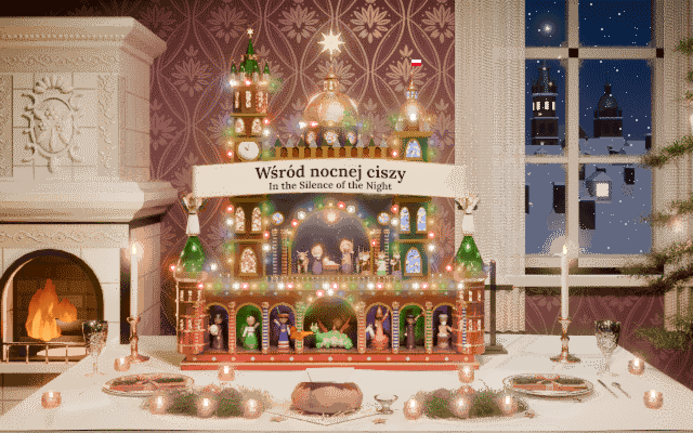
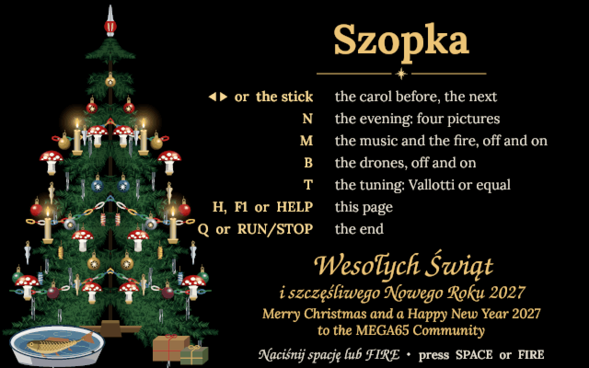
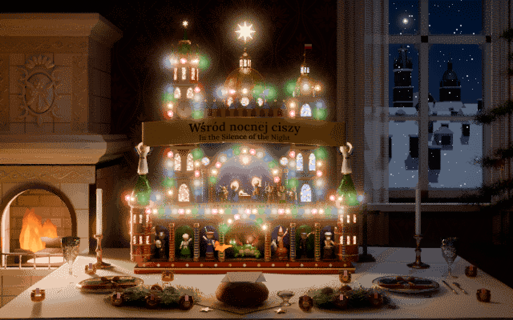
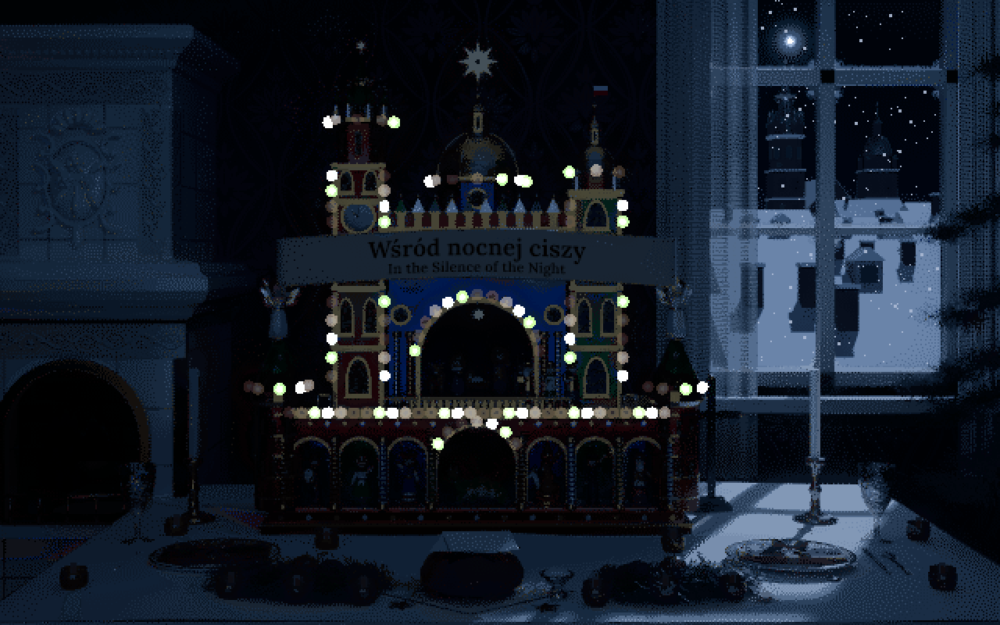

# Szopka

A Kraków room on Christmas Eve: a szopka krakowska on the table, hung with coloured bulbs; the fire
in the white stove; snow falling past the window over the old town's roofs; and 25 old Polish
carols played by a village band on the four SIDs. For the MEGA65.

The szopka is Kraków's Christmas crib: the Nativity in a palace of coloured foil built after the
city. This one has St Mary's two unequal towers, a golden dome and the Barbican's turrets; a
krakowiak, the Lajkonik and the trumpeter among its figures; and in the middle arch the Wawel
dragon, who breathes fire now and then while the room's fire burns. The evening opens at dusk: the
first star, the bulbs coming on colour by colour, the lamp, and the band begins with Wśród nocnej
ciszy. N takes the evening on through four pictures: the family's evening with every light on; the
fireside; the fire out and the bulbs alone, their light travelling in the dark room; the night,
with only the snow. The band is fiddles, basy, the dudy's drone and a lira korbowa, tuned in
Vallotti's temperament. The carols follow one another in a shuffled round, the fire heard alone
between them.

Wesołych Świąt i szczęśliwego Nowego Roku 2027.
Merry Christmas and a Happy New Year 2027 to the MEGA65 Community.

Version 1.0, 23 November 2026.

An 82-second video, with sound: [docs/szopka.mp4](docs/szopka.mp4). The landing page, its candles
catching; the opening: dusk, the first star, the bulbs, the lamp; Wśród nocnej ciszy, a gust in the
window's snow and the dragon's first breath; N to the fireside, and a breath there; N to the bulbs
alone; N to the night; N to the family's evening; cursor right: Przybieżeli do Betlejem. MEGA65;
rendered from the program's model.

## Run

Needs a MEGA65 in PAL (50 Hz) with its attic RAM: the music, the lights and the snow are timed by
the frame. The program checks both and says which is missing.

1. Download `SZOPKA.D81` from the [latest release](https://github.com/psincosoft/szopka/releases/latest)
   and copy it to the SD card.
2. `MOUNT "SZOPKA.D81"`
3. `LOAD"*",8,1`, then `RUN`

The disk's SHA-256: `f0fd50db10b5acab55056eead8339ac54291b0f8af389cd81b651cd818cb0712`.

The opening card, then the landing page with the keys and the season's wishes; its four candles
light one by one as the files load beneath it. When all four burn, SPACE, FIRE or any key begins the
piece. While it runs it borrows the memory of the ROM's copy (the hypervisor lifts its protection)
and puts everything back when it ends; if the hypervisor does not lend it, the program says so and
ends.

The disk speaks for itself: `TYPE "COLOPHON"` shows what it is, who made it and its terms (47
lines).

## Keys

| Key | What it does |
|---|---|
| CRSR left and right, or the stick | the carol before, the next |
| N | the evening's four pictures: the family's evening, the fireside, the bulbs alone, the night |
| M | the music and the fire's sound: all on; the fire's sound off; the music off; both off |
| B | the drones (the dudy's, and the lira's two drone strings): off at the start; B brings them in and takes them out |
| T | the tuning: Vallotti's temperament (at the start) or equal temperament |
| H, F1 or HELP | the landing page again, everything waiting; any key or FIRE: back |
| Q or RUN/STOP | the end: BASIC's screen as it was |
| C | the maker's CPU meter: a band of the border lit while the engine works on a frame. **The band's edge flickers: leave it off if flickering light troubles you.** |

The joystick works in either port. In the opening, any key but M, B, T, C and Q, or the stick, runs
it eight times as fast.

## What is in it

- **The room.** Christmas Eve in Kraków, about 1930: the table under a white cloth, the bread, the
  small lights among the fir twigs, two tall candles; the white stove with its fire; the wallpaper;
  the window, and through it the snow on the old town's roofs and St Mary's towers under the first
  star. The scene is built in code and rendered with Blender, then shown on the 80 x 50 text screen
  in full-colour characters: 640 x 400 pixels, one picture under four palettes, one for each of the
  evening's pictures.
- **The szopka.** Our own, built by code to the genre's rules and modelled on no maker's szopka: a
  ruby base, an arcade of seven arches, the stage with the Holy Family, St Mary's two towers, the
  Cloth Hall's attic, the golden dome, the star on its mast, and strings of small bulbs in five
  colours. Two angels hold the banner with the carol's title, the Polish above, the English beneath.
- **What moves.** The fire's flames and the two tall candles' dance, and each flame's light rises
  and falls on what it lights. The bulbs' light travels along their strings. The first star
  twinkles. Snow falls in the window and sways, and now and then a gust carries it sideways. While
  the fire burns, the dragon breathes a jet of fire, for a second and a half, every 12 to 43
  seconds. The flag on the szopka's tower is white over red.
- **The music.** 25 kolędy, 37 minutes of music: Wśród nocnej ciszy first, then the others shuffled,
  each once before any comes again, the fire heard alone between two of them. The band's instruments
  are computed from the notes on the four SIDs: the lead fiddle with its bow strokes and graces, the
  second fiddle's double stops, the three-stringed basy, the dudy's drone, the lira korbowa with its
  wheel. Vallotti's temperament gives every key its own colour, with A at 440 Hz; T changes to equal
  temperament. The drones hold one note through a carol, as the instruments are built; they are off
  at the start, and B brings them in. The carols and their sources: [CAROLS.md](CAROLS.md).
- **The fire's sound.** The flame, its hiss and its cracks on the sample channels: computed, not
  recorded.
- **The landing page.** The tree at grandma's, with its glass toadstools and its four candles, and
  the carp of Christmas Eve in its basin; the keys; the season's wishes.

## Pictures

The pictures and the video are made on a PC from a model of the program: the engine matches the
model in every frame in a 6502 emulator, and the emulator Xemu's screenshots of the engine match the
model's pictures pixel for pixel. The video's sound is the PC's: the band's notes through reSIDfp's
8580 with the fire's sound under them, and how the two balance on the machine it does not show. They
are not recordings of the machine.

## Tested on

A MEGA65 (R6A) in PAL, core 890-sdcard-native build #63 (commit 1c737937), ROM 920422.

## Credits

Szopka 1.0, 2026. Made by Dawid Blachowski at psinco., with Claude, Anthropic's AI. Dawid holds the
vision, makes the calls and the revisions, and has the final word; he played this release through
on his own MEGA65. Claude wrote the code, built the room and the szopka in code and rendered them
with Blender, drew the landing page, the flames and the dragon's fire in code, and arranged the
carols for the SID sound chip. Nothing in it comes from an AI image or sound generator, and no
generative AI runs while you play.

psinco. A Software Atelier from Luxembourg.

- The carols: every named maker of the music used died before 1926, and every source is older than
  1931; the words are not used. The melodies are read from prints of 1843 to about 1920 and, for
  Transeamus, from a manuscript copy of 1892; the settings for the band are ours. Each carol and its
  source: [CAROLS.md](CAROLS.md).
- The tuning: Vallotti's temperament, the house's tuning, chosen by Dawid Blachowski by ear on the
  MEGA65.
- The type: Lora (the Lora Project Authors; SIL Open Font License 1.1) on the banner and the landing
  page; TeX Gyre Chorus (B. Jackowski and J. M. Nowacki; GUST Font License) for the page's Polish
  wishes.
- Made with Python, NumPy, SciPy, OpenCV, Pillow, LilyPond, LZ4 and py65; the scene rendered with
  Blender; tested in Xemu; the video with reSIDfp and FFmpeg.

## Terms

Szopka is free. You may download it, run it, show it, film it, and share the disk image unchanged
and free of charge. See [LICENSE](LICENSE). Its source code is not published.

Libraries and archives may copy and keep these files, including for legal deposit.
